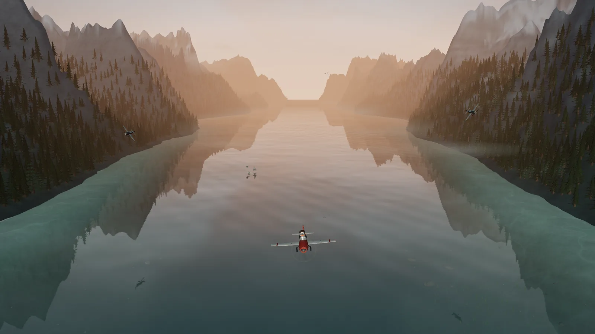
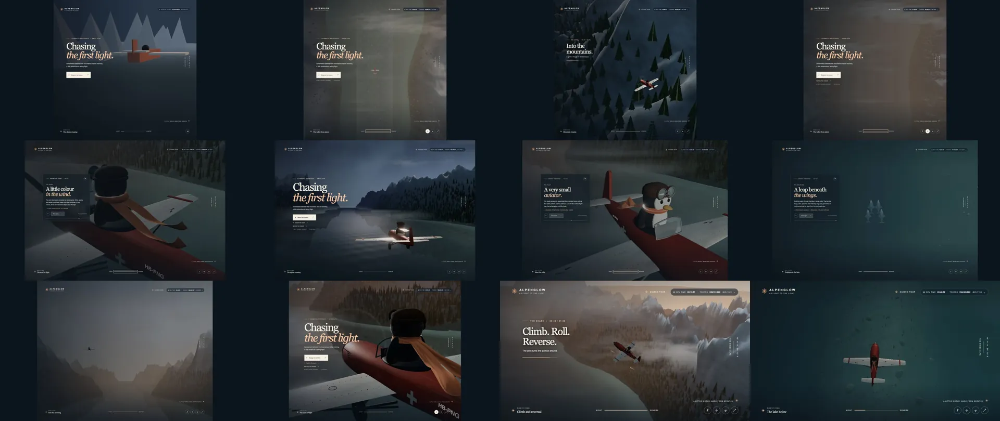

# Alpenglow — a flight to the light

A procedural Three.js film of a plush penguin pilot flying a propeller plane through an imagined Swiss alpine valley: from a moonlit lake into the sunrise, a 60-second dogfight with two pursuers, a wink at the camera and a climbing farewell. The landscape, water, clouds, wildlife, aircraft, pilot, silk scarf and every sound effect are generated in code, with no downloaded visual assets. Three.js is the sole runtime library.

Built entirely by **GPT-6.1 Terra at Max effort** (not Fast mode) in one Codex session.

**Live page:** [callmesensei.app/experiments/benchmark-plane-terra-6-1](https://www.callmesensei.app/experiments/benchmark-plane-terra-6-1) · **Run it in your browser:** [/live](https://www.callmesensei.app/experiments/benchmark-plane-terra-6-1/live)

[](https://www.callmesensei.app/experiments/benchmark-plane-terra-6-1)

## Watch

- **[The film](https://cdn.callmesensei.app/website/experiments/benchmark-plane-terra-6-1/film-db4178b1d55d73c1.mp4)**: the whole 2:36 film recorded from the live build in cinema mode (no interface), 1920×1080 with sound.
- **[Development timelapse](https://cdn.callmesensei.app/website/experiments/benchmark-plane-terra-6-1/development-timelapse-20e544dd40499c79.mp4)**: all 617 development captures in 112 seconds, each captioned with the active build time and token count when it was saved.



## By the numbers

| | |
| --- | --- |
| Active development time | **4 h 25 m** (15,918 s over 10 turns; the 3.7 h between turns are left out) |
| Tokens | **320,887,520** (316.9 M cached input, 914 k output) |
| Requests | **1,208** (604 above 272 k tokens of context) |
| Standard API equivalent | **~$37.09** |
| Development captures | **617** |

The totals are the final readings of the session meter the builder put on screen ([`usage-final.json`](usage-final.json)). Active time counts running turns only. Tokens include cached context, which is re-counted on every request. The dollar figure applies the published GPT-6.1 Terra input, cached-input, cache-write and output rates per request, including the long-context adjustment ([OpenAI's model page](https://developers.openai.com/api/docs/models/gpt-6.1-terra)); it is a hypothetical API price, not a Codex invoice, and excludes unrecorded tier, tool and tax charges.

## What's inside

- **Watch the full film** plays the 2:36 sequence: the night opening, the sunrise, the 60-second chase (two pursuers cross at staggered heights, bank through wide turns and settle behind the penguin; they overshoot below as the plane climbs, the harnessed pilot hangs inverted at the apex and rolls into a dive behind them), then the farewell: the plane approaches, the penguin raises the goggles and winks, the image holds with a motion echo, and the camera sweeps around as the plane climbs away under the end title.
- **Cinema mode** plays the film with no labels or controls. Move the pointer or tap to reveal pause and exit; Space pauses or resumes and Escape restores the interface.
- **Explore the scene / Guided tour** opens twenty-two stops explaining the techniques, with short previews of the pilot's gesture, the wake, the pursuers' overshoot, an explosion, birds, dolphins and the farewell. **Watch the chase** jumps straight to the 60-second sequence.
- Sound: the supplied score plays alongside locally synthesized engine, wind, near misses, rapid gunfire with valley echoes, water impacts and explosions. The score is gently time-fitted to the film and follows pause, seek and replay. The music-generation prompt the builder wrote is in [`SUNO_PROMPT.md`](SUNO_PROMPT.md); the recording itself (`assets/flight-to-the-light.wav`) was supplied for the film.
- The overhead lake view reveals a shallow glacial shoal with rocks, vegetation, fish and animated caustics. The water blends the lakebed with the reflected world by depth and viewing angle. Dolphin breaches trigger foam, spray and wakes; bullet strikes use finer jets and disturb the reflection separately.
- The **Night–Sunrise** line is a scrubber. Restart returns to the beginning; the arrow button changes the camera angle and the target button toggles the overhead view. `?time=314` starts the animation at that many seconds.

This is a **stylized work in progress**, not a photorealistic render. The mountains, forest, water, cockpit and plush character are procedural approximations; reaching the requested ultra-realism would need further geology and erosion, richer vegetation and lake depth, detailed aircraft construction, higher-fidelity cloth and fur, volumetric atmosphere and more refined cinematic rendering.

## Run locally

```sh
npm install
npm start          # python3 server.py: http://127.0.0.1:4173
```

Open the address in a WebGL2-capable browser. Three.js is pinned to `0.186.1` (r186). The local preview serves the modules unbundled and includes the live session meter (`/api/usage`), which reads this session's records from `~/.codex/sessions` when they are present.

```sh
npm run build      # Vite production build in dist/ (works under any base path, e.g. --base=/some/path/)
npm test           # scene, combat, audio, usage and score-streaming checks (Node.js and Python)
```

A production build has no session server: its meter shows the final totals from `usage-final.json` and is labelled FINAL. `python3 scripts/snapshot_usage.py` rewrites that file from the session records.

## Development record

[`screenshots/`](screenshots) holds the 617 numbered captures saved during development, including intermediate rendering mistakes, at their original resolution. [`screenshots/ledger.json`](screenshots/ledger.json) gives each one's save time, active build time and cumulative token count (`python3 scripts/capture_ledger.py` regenerates it). `python3 make_timelapse.py` (Pillow) assembles them into `screenshots/production-timelapse.gif`; that GIF is over 100 MB, so it is not committed. The captioned MP4 timelapse above is the published version.

## Checks

With Node.js and Python installed, `npm test` checks terrain and lakebed seams, surface crossings, the cloth simulation, the pursuers' crossing and camera framing, flight alignment and clearance, projectile travel and impact timing, score synchronization and streaming, sound events and mute behavior, usage aggregation, price calculations and idle-gap handling.
